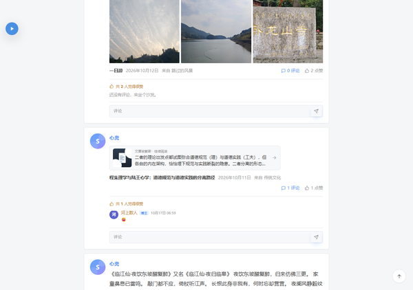

# Carefree Typecho Theme

Carefree 是一款面向个人博客的 Typecho 说说流主题：白色卡片、灰色页面、单列信息流，兼顾文章、图片、音乐、归档、相册、豆瓣和友链页面。

当前主题版本：**3.3.13**



## 目录结构

```text
carefree/                    Typecho 主题
plugins/
  SleekMusic/                音乐播放器与歌单
  SleekSticky/               文章置顶
  SleekDouban/               豆瓣书籍与电影
  BilibiliPlayer/            Bilibili iframe 响应式播放器
```

## 环境

- Typecho **1.2.x / 1.3.x**（已在 1.3.1-rc + PHP 7.4 上验证）
- PHP **7.2+**
- MySQL / SQLite（以 Typecho 支持为准）

## 安装

1. 将 `carefree` 上传到 `usr/themes/carefree`
2. 后台 → 控制台 → 外观，启用 **Carefree**
3. 将需要的插件目录上传到 `usr/plugins/`
4. 后台 → 插件，分别启用：
   - `SleekMusic`
   - `SleekSticky`
   - `SleekDouban`
   - `BilibiliPlayer`
5. 在“设置外观”中配置封面、头像、签名、配色和顶部样式

顶部封面、头像等站点图片不包含在本仓库的运行文件中，请在后台按自己的站点替换。

## 插件说明

| 插件 | 版本 | 用途 |
| --- | --- | --- |
| SleekMusic | 1.9.19 | 首页悬浮歌单、文章内联播放器、歌词与网易云歌曲 |
| SleekSticky | 1.0.3 | 在撰写页设置置顶文章，首页和列表优先展示 |
| SleekDouban | 1.0.9 | 豆瓣书籍、电影收藏页面 |
| BilibiliPlayer | 1.1.1 | 将 Bilibili iframe 包装为响应式播放器，兼容 Carefree 首页卡片 |

`BilibiliPlayer` 保留旧版 `BilibiliPlayer_Plugin` 类名别名，升级 Typecho 后无需重新激活。

## 页面模板

在“撰写 → 页面”中创建页面并选择模板：

| 页面 | 模板 |
| --- | --- |
| 归档 | `page-archive.php` |
| 友链 | `page-links.php` |
| 相册 | `page-photos.php` |
| 留言 | `page-messages.php` |
| 豆瓣 | `page-douban.php` |
| 标签 | `page-tags.php` |
| 关于 | 默认模板 |

## 许可

Carefree 主题以 **MIT License** 发布，见 [LICENSE](LICENSE)。

各插件版权归原作者所有，插件目录内保留其原始署名与说明。
