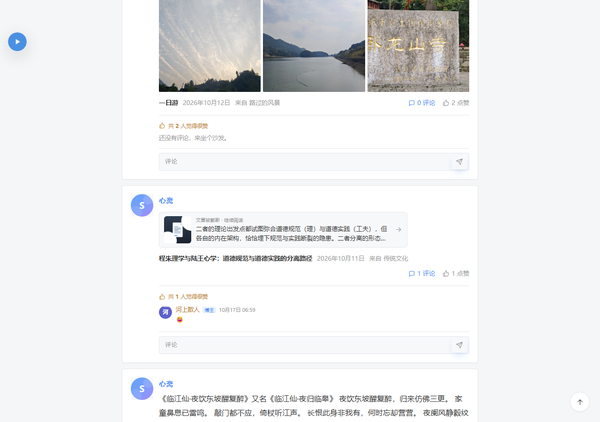

# Carefree · 说说

一个为 Typecho 打造的 **QQ空间说说风格**主题：单列说说卡片、白色卡片配灰色页面、蓝色昵称、正文大图、日期/来源和右侧互动。主题不包含侧栏和页面中间的多余设置区块。

本主题是**独立实现**，没有复制 QQ 空间的代码或素材，可以自由修改和分发。

当前版本：**2.9.47**（五种主题配色）



## 特性

- **单列说说卡片**：头像 + 昵称 + 正文 + 大图 + 日期/来源 + 互动，贴近 QQ空间说说页面
- **正文图片**：说说中的图片会以单图大图或 3 列缩略图展示，点击可查看大图
- **白色卡片 / 灰色背景**：细边框、轻阴影、蓝色昵称和蓝色互动链接
- **顶部封面导航**：大图封面 + 左下角头像/站名/签名 + 下方白色导航条，右侧搜索；封面图可在后台更换
- **登录用户身份**：登录后说说卡片显示当前用户的昵称/头像；访客仍显示站点名称
- **深色模式**：跟随系统 / 手动切换，选择写入 `localStorage`，无闪烁
- **顶部导航**：桌面端页面链接 + 搜索；移动端收成图标 + 抽屉
- **友链页面**：读取 Links 插件，头像统计 + 双列友链卡片 + 友链说明；一键添加友链按钮会滚动到评论区并预填申请格式；页面保留评论区；导航栏保持普通链接，不做下拉
- **标签页面**：按使用频率生成热力标签云，显示标签数/引用数/文章数，自动隐藏 0 篇标签；点击进入对应标签归档
- **文章详情**：作者头像/昵称信息栏，标题与元信息分层，Markdown 正文按阅读宽度排版，支持标题、列表、引用、代码块、表格和图片
- **归档时间线**：统计文章数/年份、年份跳转标签、按年份分组的时间线列表，自动读取全部已发布文章
- **相册页面**：自动聚合全部已发布文章的 Markdown/HTML 图片，三列瀑布流、文章标题/日期浮层，点击图片进入对应文章
- **关于页面**：头像/签名资料卡、文章/评论/友链/年份统计、关于本站与站点信息、最近更新列表，保留评论区
- **无限滚动**：滚动到接近底部自动追加下一页，底部显示加载 / 重试 / 到底状态；JavaScript 不可用时回退数字分页
- **滚动刷新**：数字分页默认隐藏，接近底部自动加载下一页；导航局部切换后会自动重新初始化无限滚动，不会重新露出分页条
- **截断链接卡片**：文章被截断时，摘要和图片收进「缩略图 + 摘要」卡片，正文不再重复显示摘要或图片，也不再显示「全文」
- **文章排版**：文章页保留完整标题、正文、图片、引用、代码块和表格样式
- **评论系统**：自定义嵌套评论、Emoji 选择器、博主标识、待审核提示
- **首页评论直显**：说说下方直接显示已审核评论、楼中楼回复和评论框，QQ空间楼层样式
- **评论楼层**：博主 / 待审核标记、回复缩进、头像失败自动使用首字彩色头像
- **首页音乐播放器**：配合 `SleekMusic` 插件，在首页左上角显示圆形播放按钮；播放时展开正在播放卡片，并同步页面内联播放器
- **文章音乐卡片**：文章/页面中的 `[music url="..." title="..." artist="..." cover="..."]` 会渲染为内联播放器
- **独立页面模板**：归档时间线、友链、相册、留言板
- **点赞统计**：写入 `typecho_fields`（`sleek_likes`），支持首页点赞动画与点赞数，不修改表结构
- **后台设置**：顶部封面图、顶部签名、说说卡片作者、登录用户头像、站点头像、评论头像服务、强调色、默认配色、摘要字数、建站年份、页脚信息、自定义 CSS

## 环境要求

| 项目 | 要求 |
| --- | --- |
| Typecho | 1.1 / 1.2（推荐 1.2.x） |
| PHP | 7.2 及以上 |
| 数据库 | MySQL / SQLite（Typecho 支持即可） |

主题对 Typecho 1.1 与 1.2 的表单类、Widget 类名做了兼容处理。

## 安装

1. 下载 `carefree` 文件夹，上传到 `usr/themes/carefree`
2. 后台 → 控制台 → 外观 → 启用 **Carefree**
3. 如需首页音乐，上传 `SleekMusic` 到 `usr/plugins/SleekMusic` 并在后台启用
4. 进入「设置外观」配置顶部封面图、签名、头像、强调色；首页音乐在「控制台 → 插件 → SleekMusic → 设置」里配置
5. 在「撰写 → 页面」中创建以下页面，并选择对应模板：

| 页面 | 模板 | 说明 |
| --- | --- | --- |
| 归档 | `page-archive.php` | 按年份分组的时间线 |
| 友链 | `page-links.php` | 在页面自定义字段 `links` 中填写友链 |
| 相册 | `page-photos.php` | 在页面正文中插入图片，自动生成瀑布流 |
| 留言 | `page-messages.php` | 评论区变成聊天气泡样式 |
| 关于 | 默认模板 | 普通图文页面 |

导航栏会自动读取所有独立页面，顺序与后台「页面」排序一致。建议将页面缩略名设为 `archive`、`links`、`photos`、`messages`、`about`，主题会据此匹配图标。

## 说说卡片与无限滚动

列表页采用 QQ空间说说页的单列卡片结构：

- 每张卡片：头像、昵称、正文、图片、标题/日期/分类、评论/点赞/全文
- 单图显示为大图，多图显示为 3 列缩略图，点击可查看大图
- 页面不显示侧栏、独立封面区块、日期徽标和分类栏
- 移动端卡片收窄，头像和字号自动变小

首页与归档页滚动到接近底部会自动加载下一页：

- 同时使用 `IntersectionObserver` 和滚动监听兜底
- 底部显示「正在加载…」，失败时显示重试按钮
- 全部加载完显示「已经到底啦 ~」
- JavaScript 不可用时仍显示普通数字分页

## 首页直接评论

首页每条说说的评论会直接显示在正文下方，不需要点击展开：

- 已审核评论按 QQ空间楼层样式展示，头像、昵称、时间、正文齐全
- 楼中楼回复自动缩进，并显示「回复 某人：」
- 博主会显示「博主」标记，审核中的新评论显示「待审核」
- 头像加载失败时，自动生成首字彩色头像，不会出现空白圆
- 评论框固定在楼层底部，输入后直接提交
- 提交通过隐藏 iframe 复用文章页的评论表单，保留 Typecho 的反垃圾 token 与来源页检查
- 提交成功后评论数、楼层原地更新；审核中的评论会提示「审核通过后显示」
- JavaScript 不可用时，评论数链接会直接跳到文章页评论区

## 首页音乐与 [music] 短代码

主题配合 `SleekMusic` 插件使用：

- 后台启用插件后，在「控制台 → 插件 → SleekMusic → 设置」里填写歌曲地址、标题、歌手和封面
- 首页左上角会显示圆形播放按钮；点击播放或页面内联播放器开始播放时，会展开正在播放卡片
- 播放时首页左上角同步显示歌曲封面、标题、歌手和进度；关闭卡片会收成圆形按钮
- 当前页第一首音乐会提前预加载；首次播放或网络较慢时显示“加载中…”，缓冲完成后自动播放
- 文章或页面中写 `[music url="..." title="..." artist="..." cover="..."]`，会渲染成内联播放器
- 同一页面只有一个播放器在播放，点击其他播放器会自动暂停前一个
- 浏览器限制自动播放，所以默认不自动播放，需要点击
- 如果首页播放器没有出现，检查插件是否启用、首页固定播放器开关是否打开

## 友链格式

在友链页面的自定义字段 `links` 中，每行一条：

```text
友人 C | https://www.ihewro.com | 认真生活 | https://example.com/avatar.png
甜欣屋 | http://tcxx.info | 甜欣小姐姐的个人博客
Heo | https://blog.zhheo.com | 爱折腾的设计师
```

字段说明：

- 以 `|` 分隔，顺序为：名称、链接、描述、头像
- 描述与头像可以省略
- 头像留空时显示名称首字的渐变色圆头像
- 超过一条时自动随机排序

也可以在页面正文里写介绍文字，会显示在友链卡片下方。

## 自定义字段

| 字段 | 作用域 | 说明 |
| --- | --- | --- |
| `cover` | 文章 | 列表封面图，留空自动取正文第一张图 |
| `links` | 页面 | 友链数据，格式见上 |

## 主题设置

后台 → 控制台 → 外观 → 设置外观：

- **顶部封面图**：大图封面的图片地址，留空使用深色渐变；建议 1600×400 以上
- **顶部签名**：站名下方的签名，留空使用站点描述
- **说说卡片作者**：登录用户 / 站点名称；默认登录后显示当前用户
- **登录用户头像地址**：登录后卡片使用的头像；留空自动使用登录邮箱的 Gravatar
- **站点头像地址**：未登录访客看到的头像，同时用于评论博主头像；留空使用主题内置 SVG 头像
- **评论头像服务**：默认 `https://cravatar.cn/avatar/`，国内访问更快
- **强调色**：十六进制颜色，默认 `#4a90e2`
- **默认配色**：跟随系统 / 浅色 / 深色
- **摘要字数**：首页与列表页的说说长度，默认 220
- **建站年份**：页脚版权起始年份
- **页脚附加信息**：支持 HTML，例如 ICP 备案号
- **自定义 CSS**：追加在主题样式之后

## 点赞说明

首页说说的「阅读」已替换为「点赞」按钮，文章页的阅读数也换成了点赞按钮。

- 点赞数写入 `typecho_fields` 表中 `name = sleek_likes` 的记录
- 点击后通过 `/?sleek_like=文章ID` 即时更新，不刷新页面
- 同一个浏览器通过 Cookie 只计一次，刷新后保留已点赞状态
- 点赞数为 0 时不显示「人觉得很赞」摘要，点赞后自动出现
- 不需要额外插件，也不修改表结构
- 如需清空：`DELETE FROM typecho_fields WHERE name = 'sleek_likes';`

## 目录结构

```text
sleek/
├── index.php            # 主题信息 + 首页说说流
├── header.php           # 头部、图标精灵、导航、抽屉
├── footer.php           # 页脚、灯箱、搜索层、回到顶部
├── functions.php        # 主题设置、工具函数、说说卡片、评论楼层、点赞
├── archive.php          # 分类 / 标签 / 搜索 / 作者归档
├── post.php             # 文章详情
├── page.php             # 默认独立页面
├── page-archive.php     # 归档模板
├── page-links.php       # 友链模板
├── page-photos.php      # 相册模板
├── page-messages.php    # 留言模板
├── comments.php         # 评论区与表单
├── 404.php              # 404 页面
├── screenshot.png       # 主题截图
├── LICENSE
└── assets/
    ├── css/style.css
    ├── js/main.js
    └── img/avatar.svg
```

## 二次开发

- 所有颜色、圆角、阴影都定义在 `assets/css/style.css` 顶部的 CSS 变量里，改 `--accent` 即可换主题色
- 列表卡片结构集中在 `functions.php` 的 `sleek_post_card()`
- 图标是 `header.php` 内的 SVG sprite，新增图标时加一个 `<symbol id="i-xxx">`，再调用 `sleek_icon('xxx')`
- JavaScript 无第三方依赖，使用原生 `fetch` 等基础 API

## 常见问题

**导航栏是空的？**
先创建独立页面。导航只显示首页 + 独立页面，不显示分类和标签。

**友链页面没有内容？**
确认页面模板选择了「友链页面」，并在自定义字段 `links` 中按格式填写；每行至少包含名称和链接。

**首页图片怎么显示？**
说说中的第一张图会以单图大图展示，多张图会排成 3 列缩略图，点击任意一张可以打开灯箱查看大图。如果文章没有图片，卡片就只显示文字。

**滚动加载没有触发？**
只有存在下一页时才会自动加载。请确认列表页底部有分页链接；JavaScript 被禁用时主题会直接显示数字分页，功能不受影响。

**首页评论没有显示？**
只显示已审核评论。如果后台开启了评论审核，新评论需要审核通过后才会出现；评论关闭时只显示已有评论和「评论已关闭」。

**点赞按钮点不动？**
如果按钮已经显示为橙色并带点赞数，说明当前浏览器已经点过赞，刷新后仍会保留。清空该文章对应的 Cookie 或换浏览器可以重新测试。

**评论回复按钮无效？**
请确保后台「设置 → 评论」中开启了「评论回复」，Typecho 会在页面头部输出评论脚本。

## 致谢

- [Typecho](https://typecho.org)
- 视觉参考：QQ空间说说页（白色卡片模板）
- 本主题为独立实现，不包含 QQ 空间的代码或素材

## License

[MIT](LICENSE)
